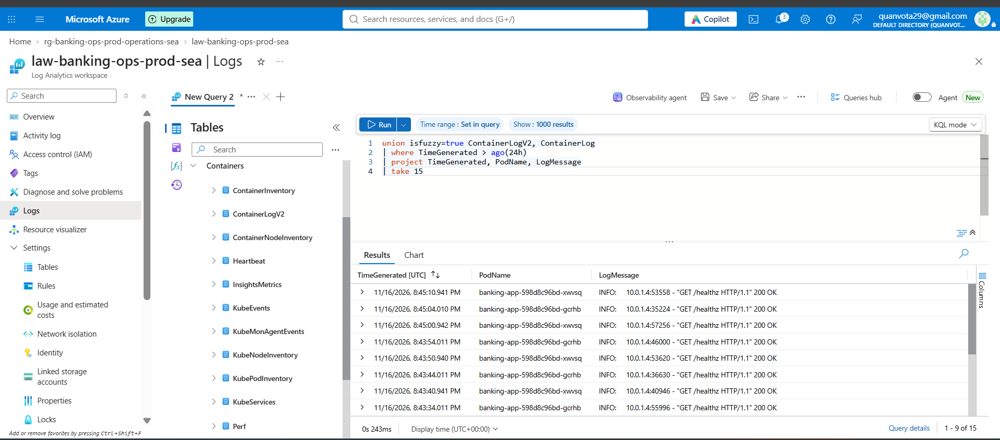
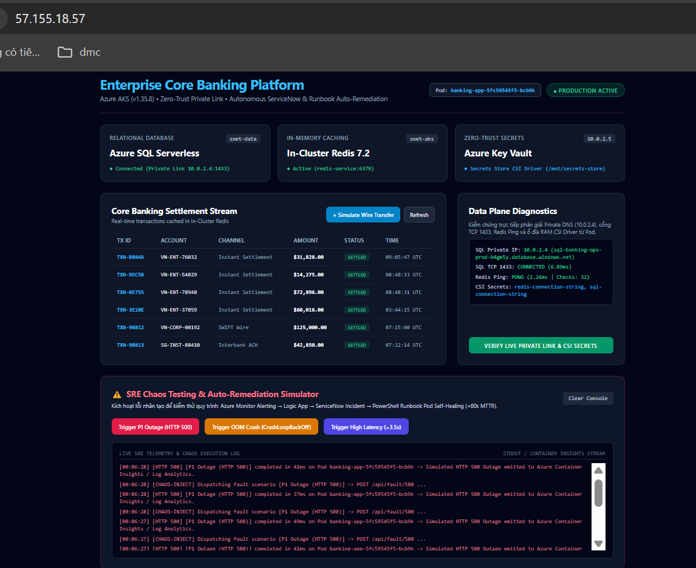
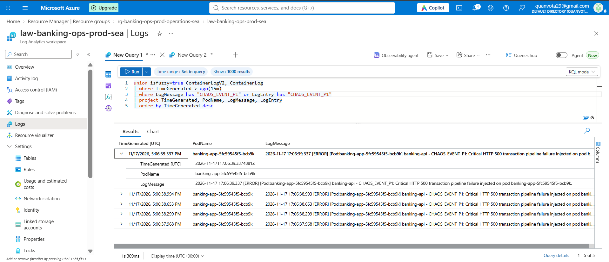
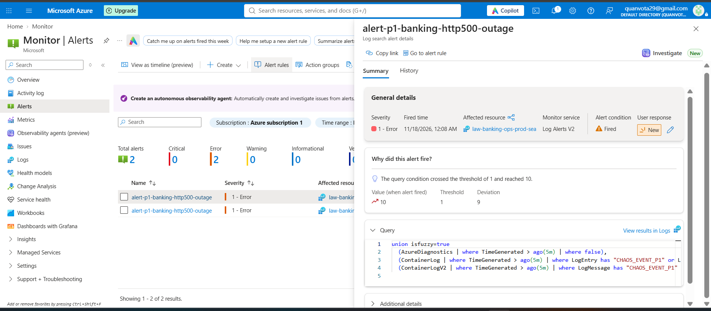
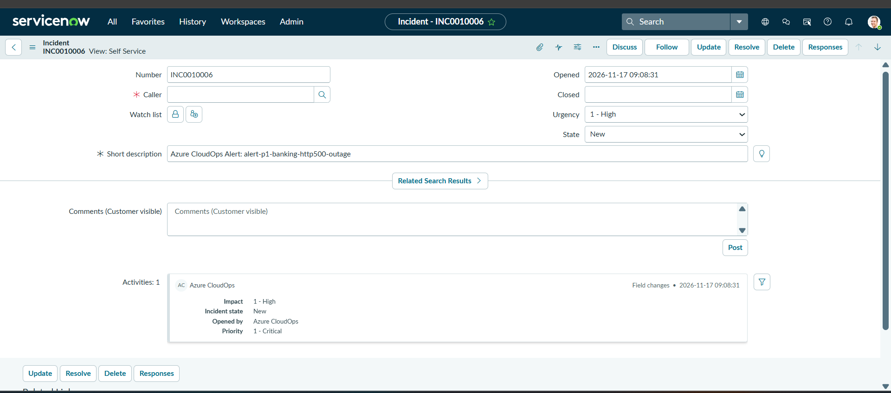
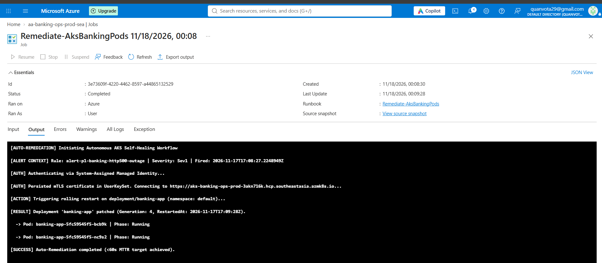
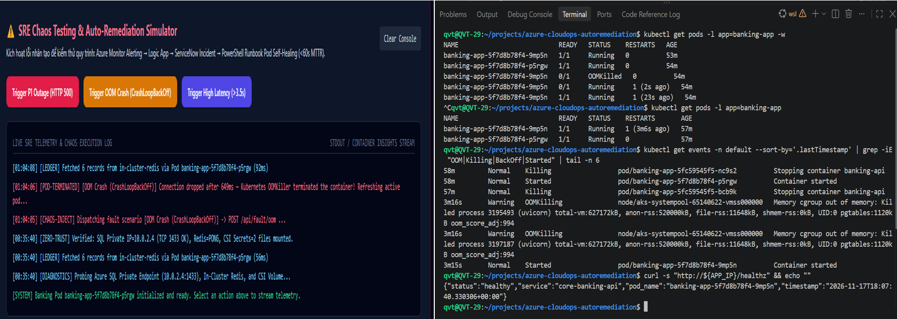

# Live Demo Walkthrough: Observability & Autonomous Incident Response

This walkthrough demonstrates the end-to-end **Closed-Loop Incident Management** lifecycle on the Core Banking Platform (`aks-banking-ops-prod-sea`):

```text
Chaos Fault Injection ──▶ Log Analytics (KQL) ──▶ Azure Monitor Alert (P1/P2) ──▶ ServiceNow ITSM Ticket + PowerShell Auto-Healing (<60s MTTR)
```

---

## 1. Observability Command Center (Full-Stack Telemetry)

Before injecting faults, full-stack telemetry is verified across **Log Analytics Workspace (`law-banking-ops-prod-sea`)**, **Container Insights**, and **Application Insights (`appi-banking-ops-prod-sea`)** to ensure zero blind spots across AKS pods and downstream data dependencies.




---


<br>

## 2. Incident Scenario #1: P1 Critical API Outage (HTTP 500)

* **Objective:** Simulate a severe transaction pipeline failure (`HTTP 500`) and verify automated detection, ServiceNow incident logging, and autonomous pod recovery in under 60 seconds.
* **Trigger:** Click **`Trigger P1 Outage (HTTP 500)`** on the SRE Chaos Simulator (or run `./scripts/chaos-test.sh 500 5`).

### Step 2.1: Fault Injection & KQL Detection
The FastAPI worker emits `CHAOS_EVENT_P1` error logs, which are ingested into Log Analytics and matched by the scheduled KQL alert rule `alert-p1-banking-http500-outage`.




### Step 2.2: Azure Monitor Alert & Automated ServiceNow ITSM Ticket
Action Group `ag-banking-ops-prod-sea` triggers Logic App `logic-banking-ops-prod-itsm-sea`, automatically creating a **Sev1 Incident** in ServiceNow PDI via the Table API.




### Step 2.3: Autonomous Pod Recovery (`<60s MTTR`)
Simultaneously, Azure Automation Runbook **`Remediate-AksBankingPods`** authenticates via System-Assigned Managed Identity and executes `kubectl rollout restart deployment/banking-app`.




---


<br>

## 3. Incident Scenario #2: P1 Container OOM Crash (`CrashLoopBackOff`)

* **Objective:** Validate High Availability (HA) continuity and self-healing when a container exceeds its `512Mi` memory limit and is terminated by the Linux `OOMKiller` (Exit Code `137`).
* **Trigger:** Click **`Trigger OOM Crash (CrashLoopBackOff)`** on the Web Dashboard (or run `./scripts/chaos-test.sh oom`).
* **Result:** Traffic seamlessly fails over to the healthy replica (`maxUnavailable: 1, maxSurge: 0`), while `alert-p1-aks-memory-oom-pressure` triggers automated pod replacement back to **`Ready: 2/2`**.




---


<br>

## 4. Incident Scenario #3: P2 Performance SLA Breach (`>3.5s` Latency)

* **Objective:** Demonstrate intelligent SRE triage differentiation—distinguishing performance degradation (`P2`) from hard outages (`P1`).
* **Trigger:** Click **`Trigger High Latency (>3.5s)`** on the Web Dashboard (or run `./scripts/chaos-test.sh latency 3`).
* **Result:** Alert rule `alert-p2-banking-high-latency-sla` detects `CHAOS_EVENT_P2` (`3500ms > 2500ms` SLA threshold) and logs a **Sev2 ServiceNow Incident** for L2 DBA/Application investigation **without** blindly restarting healthy pods.


> **📸 Screenshot Note (`04-p2-latency-triage.png`):** *Chụp màn hình dòng log cảnh báo `3500ms` trên Web Console / KQL query kèm phiếu **Sev2** trên ServiceNow (hoặc email cảnh báo P2).*

---

<br>

## 5. Standard Operating Procedures & Post-Mortem Artifacts

* **[KQL Diagnostic Playbook](./kql-diagnostic-playbook.md):** Ready-to-run KQL queries for container errors, `OOMKilled` events, and Key Vault CSI audit logs.
* **[L1/L2 NOC Runbook SOP](./runbook-sop.md):** Escalation matrix, automated verification steps, and manual CLI fallback procedures.
* **[Sample P1 Post-Mortem RCA](./rca-incident-sample.md):** Full incident timeline, 5-Whys root cause analysis, and preventive CAPA items.
